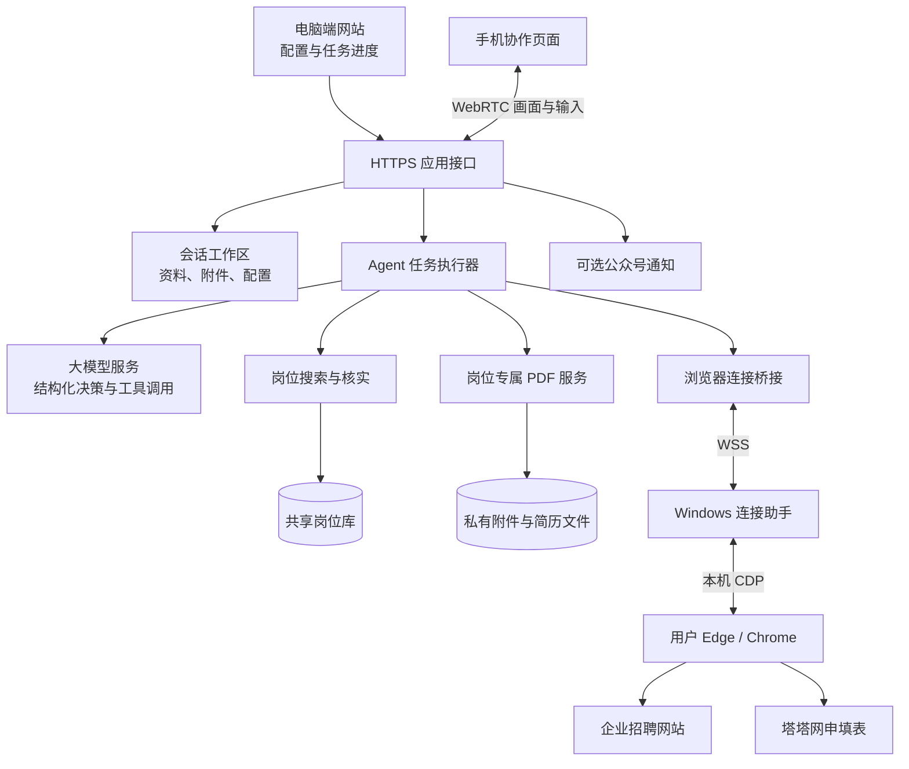
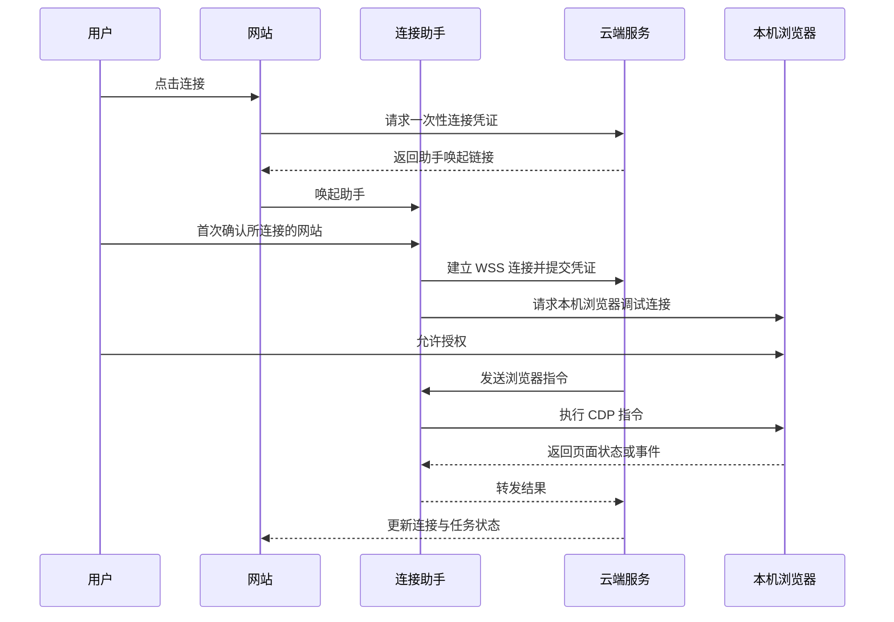

# Offerly 技术文档

**面向校园招聘的求职任务 Agent**  
版本：参赛演示版 · 2026 年 11 月 6 日

## 1. 项目概述

Offerly 面向需要在多个企业招聘官网投递简历的求职者，把岗位检索、职位理解、简历准备、网页导航、插件填表、附件上传和人工检查组织为一个连续任务。

用户提供岗位偏好和求职资料，Agent 根据实际网页状态规划下一步，调用相应工具执行。登录、验证码、资料核对和最终提交由用户参与完成。产品目标是减少跨招聘网站的重复准备和操作，让用户把时间集中在岗位判断与申请质量上。

当前采用云端服务与本机浏览器执行端协同的架构。云端运行 Agent、搜索与文档服务，本机 Windows 连接助手负责接入用户已安装插件、已登录账号的 Edge 或 Chrome。手机用于接收协助请求、查看招聘页面和临时接管操作。

系统提供两种任务入口：

- **按偏好自动找岗**：按岗位方向、城市、求职类型、薪资、经验、学历、行业、规模、发布时间等条件寻找岗位，排除用户设置的企业黑名单。
- **指定企业或网址**：用户提供企业名称、招聘官网或岗位链接，Agent 自主查找招聘入口并选择匹配岗位。

现阶段主要适配中文校园招聘场景，也允许配置实习和社会招聘。不同企业网站、网络和第三方插件的表现会影响实际完成率。

## 2. 用户使用流程

网站采用使用说明书和机器人对话结合的界面。书内保留四步准备操作，任务参数在启动对话中确认。

| 阶段 | 用户操作 | 系统结果 |
| --- | --- | --- |
| 连接浏览器 | 选择 Edge 或 Chrome，首次运行助手并开启远程调试授权，点击连接 | 网站显示连接状态，接入用户现有浏览器 |
| 准备插件 | 安装塔塔网申，登录并填写插件资料，执行试填测试 | 在简易表单中验证姓名、手机、邮箱是否填入 |
| 准备资料 | 上传简历、照片、成绩单及其他附件；按需启用岗位专属简历 | 保存文件、原始名称和资料模块 |
| 连接手机 | 生成配对链接，在手机打开；可选配置公众号提醒 | 建立有期限、可撤销的手机会话 |
| 确认任务 | 与机器人确认岗位条件、数量、黑名单、简历方案或企业清单 | 建立本轮任务和执行记录 |
| 执行与协作 | 查看进度，需要时完成登录、核对或提交 | 逐岗位记录完成、跳过或未完成状态 |

连接助手首次运行后注册网站唤起协议，后续可以从网站直接打开。浏览器连接仍需用户授权。用户应保持浏览器和助手运行。

## 3. 总体架构



系统按职责组织为以下部分：

| 部分 | 主要职责 | 实现位置 |
| --- | --- | --- |
| 交互界面 | 说明书、机器人对话、资料准备、进度显示 | `frontend/public/` |
| 公网入口 | HTTPS 请求路由、浏览器会话工作区隔离、助手和手机路由 | `frontend/hosted.py` |
| 应用接口 | 资料、附件、浏览器、任务与插件操作 | `frontend/backend.py` |
| 任务执行器 | 决策循环、工具执行、人工协助、用量控制 | `offerly/agent.py` |
| 业务编排 | 搜岗、岗位核实、批次、简历生成和目标切换 | `offerly/orchestration.py` |
| 模型适配 | Function Calling、动作校验、API 错误与 token 计量 | `offerly/model.py` |
| 浏览器接入 | CDP 会话、投递标签页隔离和助手转发 | `offerly/browser_connection.py`、`offerly/connector.py` |
| 本机助手 | 协议唤起、连接授权、双向转发、临时附件 | `tools/OfferlyConnect.cs` |
| 文档服务 | 资料模块、定制内容校验、PDF 排版与预览 | `offerly/resume*.py`、`frontend/resumes.py` |
| 岗位与历史 | 岗位入库、去重、投递记录 | `frontend/job_*.py`、`offerly/history.py` |
| 手机协作 | 配对、视频、输入、任务回复与通知 | `frontend/phone.py`、`remote.py`、`wechat.py` |

通用浏览器自动化运行时与业务工具一起构成 Agent 的执行能力。页面读取、定位、导航和输入由运行时提供，Offerly 在此基础上组织求职任务和相关业务服务。第三方依赖和许可证随仓库保留。

## 4. Agent 决策与执行

### 4.1 决策闭环

执行器将任务目标、岗位偏好、候选人资料、当前网页状态和已有工具结果提供给模型。模型返回结构化动作，程序校验后执行，再读取实际结果，进入下一次判断。

```text
任务目标与资料
    → 读取当前页面和任务状态
    → 模型返回结构化工具调用
    → 参数、权限及业务条件校验
    → 执行工具
    → 返回页面变化、工具结果或错误
    → 继续决策 / 等待用户 / 结束任务
```

模型通过 Function Calling 返回包含动作列表的完整决策对象。工具名称、参数和数据类型受 Schema 约束，Pydantic 在执行前验证返回内容。模型接口保留映射类参数的实际结构，支持按资料条目 ID 提交简历改写方案。

模型提供语义判断，程序负责执行边界。比如岗位是否匹配由模型结合资料与 JD 判断，黑名单、附件授权、当前岗位状态和重复投递检查由业务代码校验。

### 4.2 核心工具

| 工具 | 作用 |
| --- | --- |
| `read_candidate_profile` | 读取结构化资料，或从用户简历提取选岗依据 |
| `search_jobs` | 批量检索岗位，返回已核实岗位及待核实线索 |
| `confirm_job` | 从搜索结果选入本批，无需先打开详情；官网核实的完整岗位可另行入库 |
| `choose_job` | 激活当前岗位，返回该岗位的资料和附件上下文 |
| `generate_resume` | 根据模型给出的改写方案生成本岗 PDF |
| 导航、切换、点击、输入、下拉、滚动 | 访问招聘入口并操作当前网页 |
| `upload_file` | 将当前岗位已授权的文件上传到页面控件 |
| `use_tata` | 在当前申请标签页触发插件填表 |
| `ask_user` | 遇到登录、验证码或需要协助的问题时暂停等待 |
| `request_review` | 交用户检查资料并亲自提交 |
| `skip_applied_job` | 核实官网已投递状态，自动处理重复岗位 |

工具报错会作为下一轮决策依据。请求预算、浏览器中断或不可恢复错误会结束或暂停任务，并保留已知进度。

### 4.3 岗位搜索与批次

自动找岗先从已有岗位库中检索，并结合全网搜索寻找候选链接。每个 Tavily 基础请求最多获取 20 条搜索结果；一次 `search_jobs` 工具调用可以组织多个检索请求，不能将“一次工具调用”等同于“一次搜索额度”。

搜索结果分成已核实岗位和待核实线索。Agent 根据结果中的企业、具体岗位名称、详情链接、地区和摘要选择本批岗位，无需先逐个打开浏览器。招聘首页或没有具体职位的聚合页面不占本批名额；摘要只用于初步匹配，不作为完整 JD 或已核实岗位入库。凑齐后再依次进入企业官网，读取完整 JD 并准备申请。

每批先从岗位库与搜索结果中确定 min(5, 剩余投递数) 个岗位；不足继续搜索，凑齐后才依次打开执行。岗位库已有足够可用候选时不调用全网搜索，已齐备的批次不重复搜索。黑名单在候选筛选、批次登记及已知链接导航等环节检查。

申请入口必须是企业官网或企业专属招聘站。第三方招聘平台和高校就业信息站仅作线索，需要另行找到对应企业官方入口。程序拦截已知第三方平台域名，其他站点的企业归属仍需 Agent 依据搜索与网页证据判断。

搜索期间发现的公共岗位信息可以进入共享库。岗位库与个人资料分离，保存企业、职位、JD、链接及核实状态等公开招聘信息。

### 4.4 已投递岗位与数量口径

官网详情页若明确显示当前岗位“已投递”或“已申请”，工具结合岗位 URL、标题与可见状态进行核实。核实后记录 `already_applied`，直接继续，不再要求用户确认这一历史状态。

自动找岗任务会替换该名额，继续处理本批其余岗位，并在后续补搜。历史申请不计入本轮新增投递数。用户指定企业清单时，已投递企业直接跳过，继续下一项。

用户确认提交、官网历史已投递、用户主动放弃和未完成分别记录。当前用户主动放弃仍按处理一个目标的语义执行；界面与统计应区分“已处理目标数”和“用户确认提交数”。

## 5. 简历与附件

### 5.1 简历方案

用户可以直接使用已有简历，也可以选择岗位专属简历。

自带简历用于资料提取和选岗，并按原文件上传。专属方案使用个人优势、教育经历、实习经历、项目经历、校园经历及用户自定义模块。Agent 阅读 JD 后调整表述侧重点，生成适合该岗位的简历。

定制内容在当前决策中通过工具参数提交，常规 Agent 路径的 PDF 生成工具不再额外请求一次模型。内容方案包括条目改写、条目顺序和岗位重点。

每条改写关联原资料条目 ID。校验包括条目存在、普通经历引用范围、原文引述一致性及数字依据检查。程序保留姓名、学校、企业、日期等结构化事实。这些检查有助于限制无依据改写，文字语义仍需要用户核对。

PDF 通过排版服务生成，优先优化到一页；内容过多时不保证强行压成一页。文件按“姓名-岗位”命名。手机可查看当前岗位信息并直接预览简历页面。

### 5.2 附件顺序和传输

申请页面需要附件时，先上传并等待网站解析完成，再触发塔塔填表，降低附件解析覆盖已填字段的风险。

每个文件保存原始名称、类型、大小和内容摘要，上传时使用当前岗位对应的授权路径。单文件上限为 20 MB，全部附件上限为 100 MB，具体企业可能有更严格限制。

云端文件路径无法直接作为用户电脑上的上传路径，因此助手链路会：

1. 检查文件属于当前工作区。
2. 将文件发送给本机助手。
3. 在该连接的临时目录中按原文件名保存。
4. 将本机路径交给浏览器上传控件。
5. 连接结束后清理本次临时目录；异常退出可能需要后续维护清理。

第三方插件承担招聘表单的具体填写。系统验证插件是否被触发并观察执行状态；这不等于证明所有字段正确，最终内容由用户检查。

## 6. 浏览器连接与手机协作

### 6.1 本机连接助手

助手是 Windows 桌面程序，采用系统 .NET Framework、WinForms 和 ClientWebSocket，不需要管理员权限。首次运行安装到当前用户目录并注册 `offerly-connect` 协议，重复唤起通过单实例通信交给已有窗口。



连接凭证有效期为 10 分钟，成功兑换后失效。助手主动连接网站，不要求用户开放公网浏览器端口，也不自行做模型决策或增加模型请求。

Agent 的投递标签页由连接层登记和管理。个人标签页不进入常规 Agent 标签列表；相关 CDP 会话与目标校验沿用同一连接层。

### 6.2 手机协作

手机配对链接有效期为 10 分钟，兑换后生成最长 8 小时的手机会话。用户可在电脑端撤销连接。公开部署下，手机请求根据配对凭证或会话凭证路由到对应工作区。

需要用户协助时，任务进入 `WAITING_HUMAN`。浏览器画面通过截图帧采集后编码为 WebRTC 视频，输入通过有序数据通道传递，再转成 CDP 操作。跨网络连接使用配置的 STUN/TURN 服务。手机查看连接与 Agent 的 CDP 会话分别管理，手机画面关闭时不应中断 Agent 的浏览器消息读取；检测到浏览器连接已断开后停止新增模型请求。当前文字模型的常规页面读取不额外采集截图，手机实时画面仍使用独立的视频采集链路。

用户可以完成协助后交还 Agent，也可以确认该岗位已提交或放弃当前岗位。用户回复包含当前任务与岗位标识，避免将旧页面的回复用于另一个目标。

可选公众号提醒在电脑端保存用户自己的 token。通知用于提醒用户返回协作页面，控制权限仍由手机配对会话验证。

## 7. 状态、存储与权限

### 7.1 任务状态

| 状态 | 含义 |
| --- | --- |
| `STARTING` | 检查资料、浏览器和执行条件 |
| `RUNNING` | Agent 正在判断或执行 |
| `WAITING_HUMAN` | 等待登录、验证、检查或用户回复 |
| `PAUSED` | 用户暂停 |
| `FINISHED` | 本轮目标处理结束，应结合各岗位结果判断提交情况 |
| `STOPPED` | 用户主动停止 |
| `BUDGET_EXHAUSTED` | 达到模型请求预算 |
| `FAILED` | 出现未恢复的执行错误 |

执行过程保存阶段、时间线、当前岗位、已确认批次及模型用量。服务器重启后可以读取保留记录，但当前版本不能保证自动恢复模型全部记忆和浏览器现场，恢复时需要重新连接并核对状态。

### 7.2 数据存储

| 数据 | 保存方式 | 范围 |
| --- | --- | --- |
| 资料模块及附件元数据 | JSON | 私有工作区 |
| 原始附件、生成 PDF | 文件目录及摘要校验 | 私有工作区 |
| 岗位信息及检索线索 | SQLite | 共享公共招聘信息 |
| 投递历史 | SQLite | 当前工作区 |
| 任务快照 | JSON | 当前工作区 |
| Windows 本地凭据 | DPAPI | 当前 Windows 用户 |
| Linux 服务配置 | 权限受限的配置文件或环境变量 | 服务端 |

公网工作区通过安全 Cookie 标识，具有 Secure、HttpOnly、SameSite 属性。每个工作区使用独立 API 会话令牌。当前隔离基于浏览器会话，尚未提供完整的用户账号、跨设备身份和组织权限体系。

服务端模型和搜索凭据不返回给前端。浏览器登录状态保留在本机配置中；网页内容、用户上传的附件和模型需要的资料仍会经过云端处理，因此不能将该架构描述为“资料完全不出本机”。

### 7.3 执行保护

系统校验工作区版本、文件归属、岗位链接、黑名单及常见最终提交动作。遇到需要最终确认的申请，交用户检查并提交。页面与 JD 作为任务数据处理，不应被当作系统指令。

这些保护针对现有工具和常见流程，不构成对任意网站脚本行为的完整安全证明。当前版本仍应在真实网站中观察执行，并由用户核验重要动作。

## 8. 部署与运行

### 8.1 环境

- Python 3.13，使用 uv 和锁文件管理依赖。
- Node.js 22.19 或更新版本，用于岗位采集组件。
- Windows 用户端安装 Edge 或 Chrome，以及已配置资料的塔塔网申。
- Linux 服务端部署 HTTPS 反向代理；跨网络手机协作配置 TURN。
- PDF 服务提供可嵌入的中文字体，可通过 `OFFERLY_RESUME_FONT` 指定。

### 8.2 本地启动

```powershell
uv sync --frozen
npm --prefix frontend/job-search ci --ignore-scripts --no-audit --no-fund
.\start-offerly.ps1
```

电脑入口默认是 `http://127.0.0.1:9189/`。本地启动脚本可以配置局域网手机入口；存在配套隧道程序时可建立临时 HTTPS 手机入口。

### 8.3 云端启动

```bash
uv sync --frozen
npm --prefix frontend/job-search ci --ignore-scripts --no-audit --no-fund
uv run python -B -m frontend.serve \
  --public-origin https://offerly.example.com \
  --data-dir /var/lib/offerly/workspace \
  --phone-ice-config /etc/offerly/phone-ice.json
```

网站域名替换为实际 HTTPS 地址。程序监听环回地址 9189，由反向代理统一转发网站、`/api/`、`/browser-helper/relay` 和 `/phone-api/`。WebSocket 转发需要保留 Upgrade 头并关闭不合适的缓冲。

`/healthz` 用于检查应用进程是否可以响应，不代表浏览器、第三方网站和模型服务全部可用。

服务器模型默认配置位于工作目录下的私有 `model.json`，包括 `provider`、`model`、`baseUrl`、`apiKey`。Tavily 可以通过 `OFFERLY_TAVILY_API_KEY` 配置。ICE 配置文件分别提供 `client` 与 `server` 数组。配置文件、证书私钥、用户附件和通知 token 均不得提交到代码仓库。

当前正式站采用单机进程与服务管理器运行，尚未交付容器化部署、跨节点任务调度及自动扩缩容。云端负责 Agent 与业务服务，本机助手承担浏览器执行，部署和工程能力应按这一实际状态描述。

### 8.4 助手构建

在 Windows 上运行：

```powershell
powershell.exe -NoProfile -ExecutionPolicy Bypass -File .\tools\build-connector.ps1
```

产物位于 `frontend/public/downloads/OfferlyConnect.exe`。将该文件随网站发布后，用户可从第一步下载。当前构建未提供商业代码签名；后续正式分发应补充签名、版本管理和升级机制。

## 9. 验证方式与已有证据

测试分为协议与业务单元测试、本地浏览器集成测试、公网连接验证，以及真实用户招聘网站测试。各层结果分别记录，避免把本地模拟成功等同于真实网站全部可用。

| 验证层 | 已覆盖的内容 | 适用边界 |
| --- | --- | --- |
| 协议与业务 | 结构化工具请求、返回校验、简历依据校验、岗位批次、重复岗位补足、文件归属 | 模型响应使用可控测试数据，不证明真实模型总能正确输出 |
| 本地浏览器 | 标签切换、附件上传顺序、插件触发模拟、手机交接、多岗位继续 | 使用隔离浏览器和本地招聘页面；填表插件部分采用可控测试入口 |
| 助手集成 | Windows 可执行文件、中转指令、原文件名上传、断开及重连、临时目录清理 | 本地测试与公网测试覆盖范围不同 |
| 公网部署 | HTTPS 网站、助手下载一致性、WSS 连接、云端控制本机浏览器、手机配对 | 尚不能据此推定所有手机网络和所有招聘网站均可完成 |
| 真实招聘 | 已有用户实际运行记录，可定位岗位导航、登录和流程阻塞 | 最新协议和已投递处理修复仍需后续真实任务验证 |

截至本版，已执行协议和批次专项回归、本地多岗位浏览器回归，以及助手公网连接验证。最近一次真实运行暴露了选岗阶段成本偏高、历史已投递岗位阻塞和动作返回格式问题；对应修复已加入，完整真实投递成功率尚未形成系统统计。

开发者可运行：

```powershell
.\.venv\Scripts\python.exe -B -m unittest discover -s tests -v
node tests/test_book_frontend.mjs
node tests/test_phone_keyboard.mjs
```

浏览器集成测试需要可用的系统浏览器，助手测试需要先构建 Windows 产物。测试使用临时数据，不需要付费模型密钥；部分测试具有特定平台要求。

## 10. 成本、限制与后续优化

系统记录模型请求次数、输入及输出 token；每轮最多 100 次模型请求，余额不足等明确错误会停止继续请求。一次 Agent 决策和一次实际模型请求不必然相等，评估成本应以实际计量为准。

搜索服务记录搜索额度与页面请求信息。公共岗位复用、搜索线索落库、批次内复用 JD 和工具内直接生成 PDF 用于减少重复外部请求。

当前尚无标准化的平均单岗费用、耗时分位数和真实网站成功率结论。计算模型费用时，需要结合实际模型价格、缓存命中情况和搜索服务账单，不能仅用总 token 数给出固定费用。

主要限制包括：

1. 招聘网站结构、登录和验证码存在差异，插件也受站点支持范围影响。
2. 搜索结果可能只有企业入口，需要浏览器逐站核实，增加延迟和请求量。
3. 手机画面受源画面、编码和网络影响；TURN 可改善连通性，但不能消除延迟。
4. 云端和本机助手中任一连接中断都可能暂停任务，当前尚无完整的无人值守恢复能力。
5. 现阶段是单机演示部署，公网入口限制同时在内存中的工作区和运行任务数量，不能据此宣称大规模并发能力。
6. 人工检查和最终提交属于产品流程的一部分，申请准备完成与用户确认提交应分别统计。

后续优先完善真实网站回归样本、失败分类、搜索命中率、上下文压缩和端到端费用统计，再逐步补充容器化、任务队列、账号体系及更完善的恢复能力。
